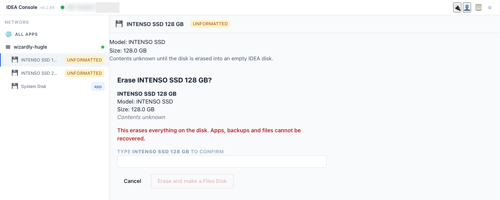
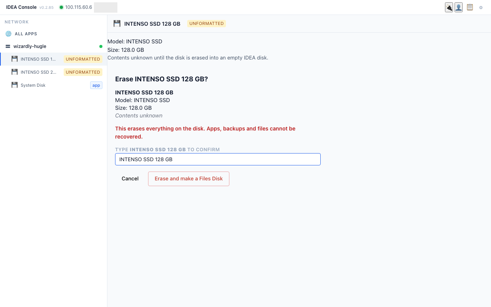
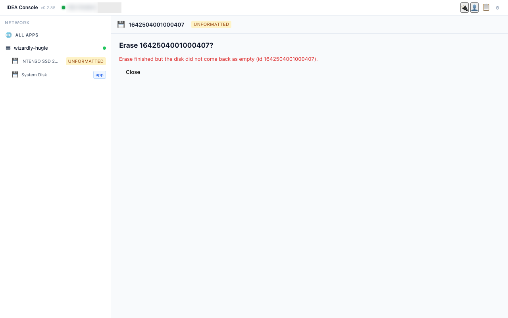
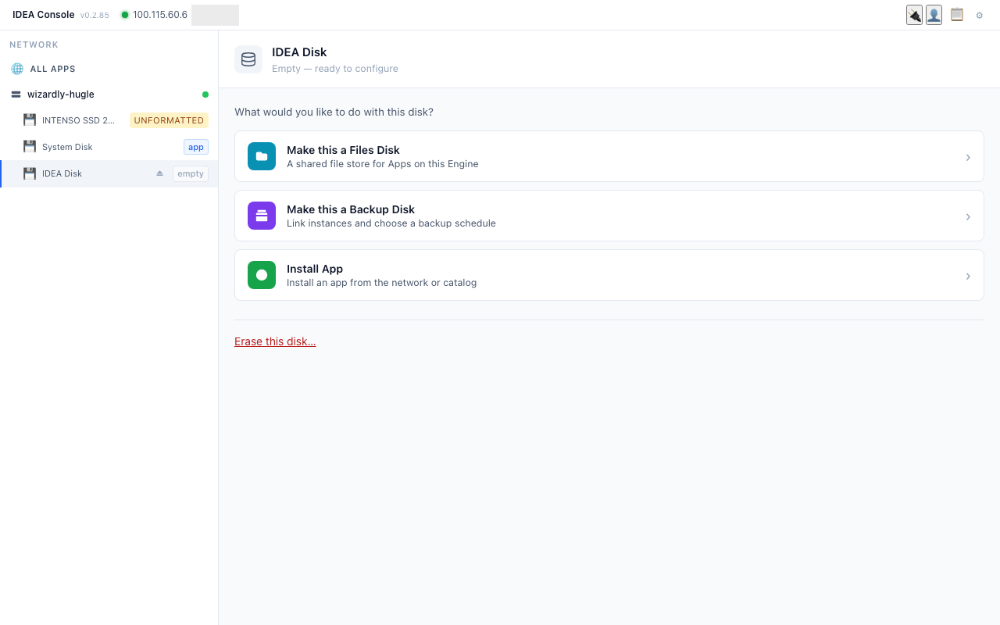

# 8. Bringing your own content (Files Disk) — read-only parts

Preparing a Files Disk changes a disk and is done by the operator on a test Pi (not in this demo). This chapter explains what it is and how teachers use it once it exists.

## What a Files Disk is
- A USB stick or disk that the operator turns into a shared file store in the Console. It shows the **files** badge.
- Its folder (for example **School Files**) appears inside **Nextcloud**. In version 1 it is available **only in Nextcloud**, not in Kolibri.
- **Backups do not cover Files Disk content** in version 1. Keep your own copy of important files.

## F2. Use downloaded material in Nextcloud (disk already prepared)
1. In the Console, click the disk: it says "Available in: Nextcloud" (**to confirm** deployed). <!-- screenshot:F2-01 -->
2. Open Nextcloud. Open the **School Files** folder. <!-- screenshot:F2-02 -->
3. Copy the worksheet you need into a class folder, then share it as in N1. <!-- screenshot:F2-03 -->

## F3. Can I put my own files into Kolibri?
Not directly. Kolibri only imports ready-made **Kolibri channels** (from Kolibri Studio online, another Kolibri server, or a drive with a channel exported from another Kolibri). Your own videos/PDFs must first be built into a channel on Kolibri Studio, which needs internet and an account.
On our IDEA setup, Kolibri does not see USB disks or the Files Disk, so "Import from attached drive" is not available today. Use Nextcloud for your own files, and Kolibri for the prepared lessons.

Note (not yet tested on IDEA): Kolibri can also copy channels from **another Kolibri server on the same local network**, without internet (Device > Channels > Import > "Local network or internet", enter the other server's address). Both servers need Kolibri 0.11 or later. This only moves ready-made Kolibri channels, not your own files. Source: Kolibri docs, "Import from a local network or internet".

## F1. Making a Files Disk (operator, captured 2026-10-12, run did not finish)
1. Select the new disk (UNFORMATTED badge), click **Make this a Files Disk**. The panel **MAKE THIS A FILES DISK** asks for a **SHARE NAME** and offers **Erase the disk first** ("Removes everything on it, then makes it a Files Disk").
2. The confirmation **Erase <disk>?** shows model, size and contents. Type the disk name exactly, then click **Erase and make a Files Disk**.
   
   
3. **Known issue (being fixed):** in Console v0.2.85 the erase can finish correctly while the Console says "Erase finished but the disk did not come back as empty" and the disk disappears from the list. The erase did work; an Engine bug hides the disk afterwards, and it reappears as an empty **IDEA Disk** once the IDEA team has restarted detection. If you see this message: do **not** erase again and do not unplug the disk. Call your IDEA contact.
   

### F1 on a disk that is already an empty IDEA Disk (captured 2026-10-12, completed)
1. Select the **IDEA Disk** marked **empty**. The view asks "What would you like to do with this disk?": **Make this a Files Disk**, **Make this a Backup Disk**, **Install App**, and **Erase this disk…** at the bottom.
   
2. Click **Make this a Files Disk**. The panel explains "Nothing on the disk is erased", with **SHARE NAME** pre-filled as **School Files**. Click **Make this a Files Disk**. (The red **Erase the disk first** is only for disks with other content.)
   
3. After a short wait the disk shows the **files** badge, "Share name: School Files", free space (here 119.0 GB free of 125.4 GB), an **Eject** button and **Erase this disk…**.
   

### F2. Files Disk in Nextcloud: not available on the demo box yet
The Files Disk view says **"No App on this Engine uses Files Disks yet"**, and no School Files folder appears in Nextcloud for demo-teacher1. The Nextcloud app installed on the demo box (1.0-31.0.1) does not use Files Disks yet (**to confirm** with the App team which version adds it). Until then, teachers keep using normal Nextcloud folders (chapter 5).
Reminder: in version 1 a Files Disk is for Nextcloud only (not Kolibri), and **backups do not cover Files Disk content**.
