# 9. Keeping data safe: the Backup Disk (concepts)

Making and restoring backups is done by the operator and practised on a test Pi. Teachers should know:
- A **Backup Disk** is a separate disk with the **backup** badge in the Console.
- It saves the **apps' data**: Kolibri (classes, learners, progress) and Nextcloud (accounts, files inside Nextcloud).
- It does **not** save Files Disk content (version 1).
- During a backup, the app stops for a short time and then starts again. Plan backups outside lesson time.
- If a Pi breaks, the operator restores the latest backup onto a new disk. You lose only what was done after the last backup.
- Never unplug a disk while a backup is running. If it happens, the backup restarts next time the disk is connected.
How often the school backs up (each time the disk is plugged in, or on request): **to confirm** per school.

## Hands-on (operator, captured on the demo box 2026-10-12/13)

### B2. Make a Backup Disk
1. Plug in a spare disk. If it is new, it first has to become an empty **IDEA Disk** (chapter 8, Erase).
2. Select the **IDEA Disk** marked **empty** and click **Make this a Backup Disk** ("Link instances and choose a backup schedule").
   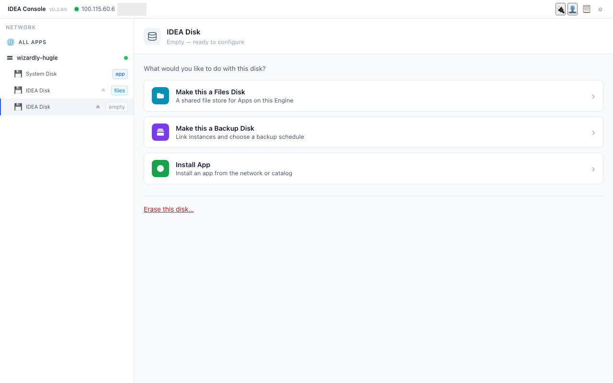
3. Choose when backups run: **On demand** (only when you press **Back up**; used in the demo), **Immediate** (as soon as the disk is docked) or **Scheduled**.
   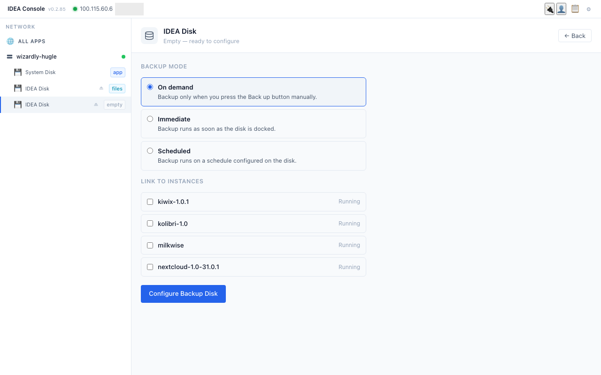
4. Under **LINK TO INSTANCES**, tick only the school apps to protect (demo: **kolibri-1.0** and **nextcloud-1.0-31.0.1**). Leave other apps unticked.
   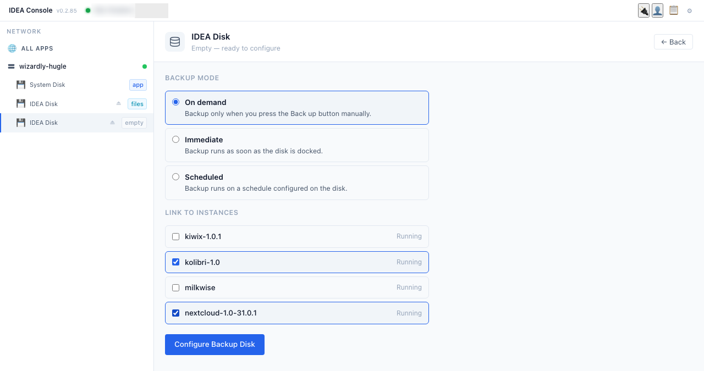
5. Click **Configure Backup Disk**. The disk gets the **backup** badge and a **Backups** list: each linked app, "Never backed up", and **Restore**.
   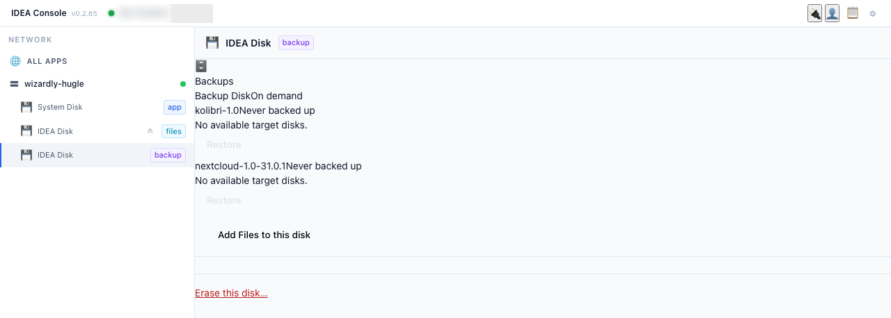

### B3. Run a backup
1. In **ALL APPS**, each linked app row has a **Back up** button next to Start / Stop / Open. Click it for Kolibri.
   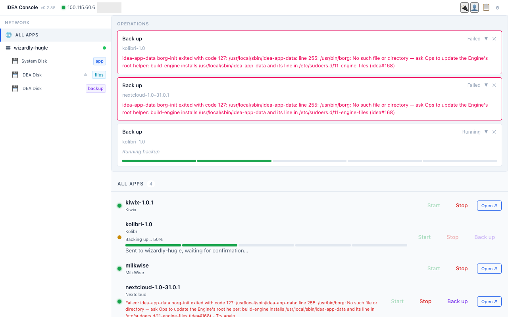
2. The app stops for a short time while it is copied, then starts again. On the Backup Disk the app shows **Operation in progress**. Do this outside lesson time.
   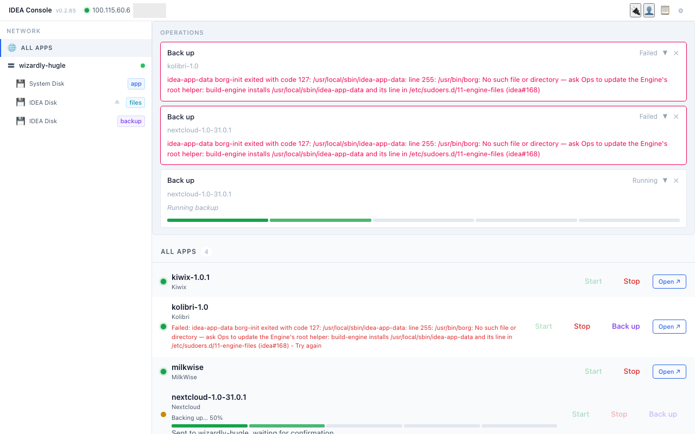
3. When it is done, the Backups list shows **Last backup: <date, time>** (demo: Kolibri 8:46, Nextcloud 8:49, about 3 minutes each). Repeat for Nextcloud.
   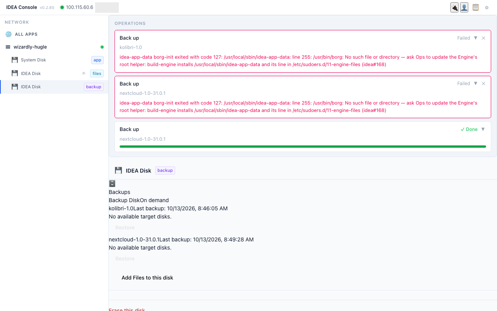
4. The **OPERATIONS** box at the top keeps old messages (in the demo: failed attempts from the day before, when the backup tool was not yet installed). Check the **Last backup** time, not old messages. Close old messages with ✕.

### B4. Restore after a crash
1. On the Backup Disk, each app in the **Backups** list has a **Restore** button.
   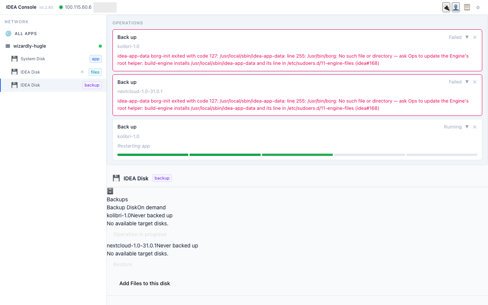
2. Restore needs a **target disk**: a spare, empty IDEA Disk to put the app on. On the demo box it says **"No available target disks."** because the only other disks are the Files Disk and the System Disk, and the Console does not offer those as targets.
3. With a spare empty IDEA Disk plugged in, choose it as the target and confirm (**to confirm**: not tried yet; by design the latest backup is unpacked onto the target disk and the app runs from there).
Never restore onto a disk that holds other apps you need.

> **Erasing a Files Disk that an app is using.** If Nextcloud is using the Files Disk (School Files), the erase cannot run because the disk is busy, and the Console gives no clear error. Stop Nextcloud first (with your IDEA contact), then erase.

#### B4 on the demo box (2026-10-13): restoring Kolibri onto a spare disk
Before you start you need a spare, **empty IDEA Disk** (here the 128 GB disk, erased first; see the note above about stopping Nextcloud).
1. Open the **Backup Disk**. In the **Backups** list each app shows **Last backup: <date, time>**, a **Select target disk…** list and a **Restore** button (grey until a target is chosen).
   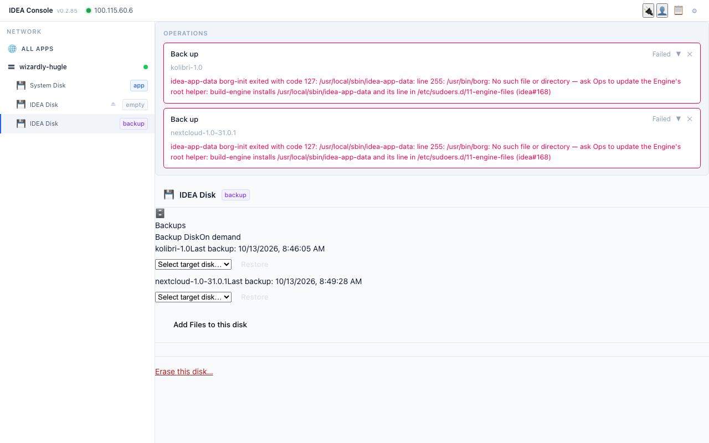
2. In **Select target disk…** choose the spare disk. Only spare, non-system disks are offered (here one **IDEA Disk**). Then click **Restore**.
   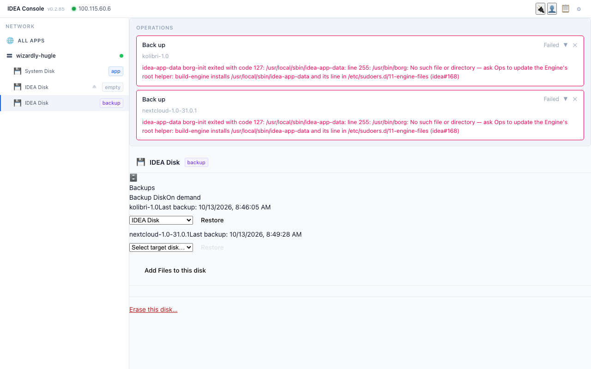
3. The Console asks: "Are you sure? This will overwrite **kolibri-1.0** on **IDEA Disk**." Click **Confirm Restore** (or **Cancel**).
   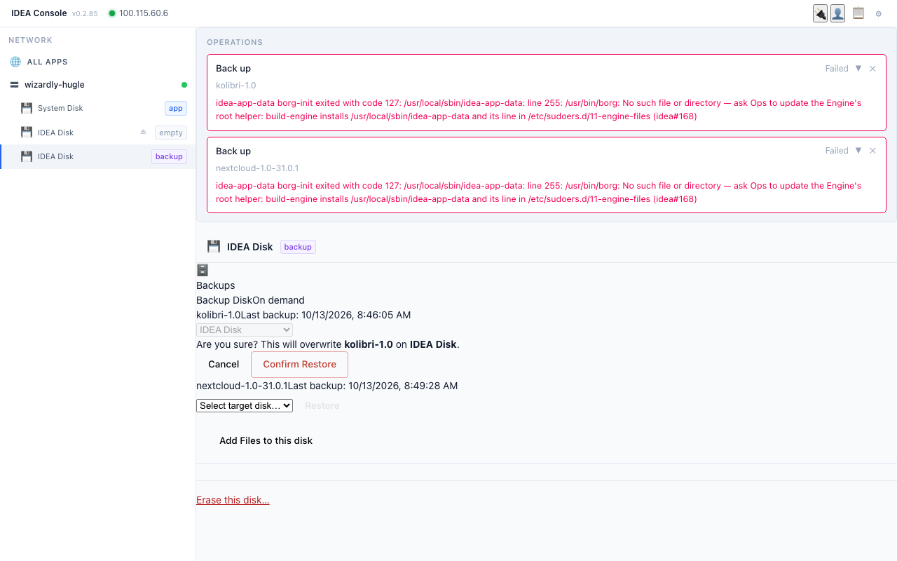
4. After about a minute the spare disk shows the **app** badge and lists **kolibri-1.0**.
   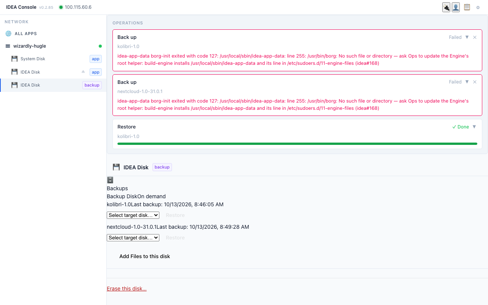
   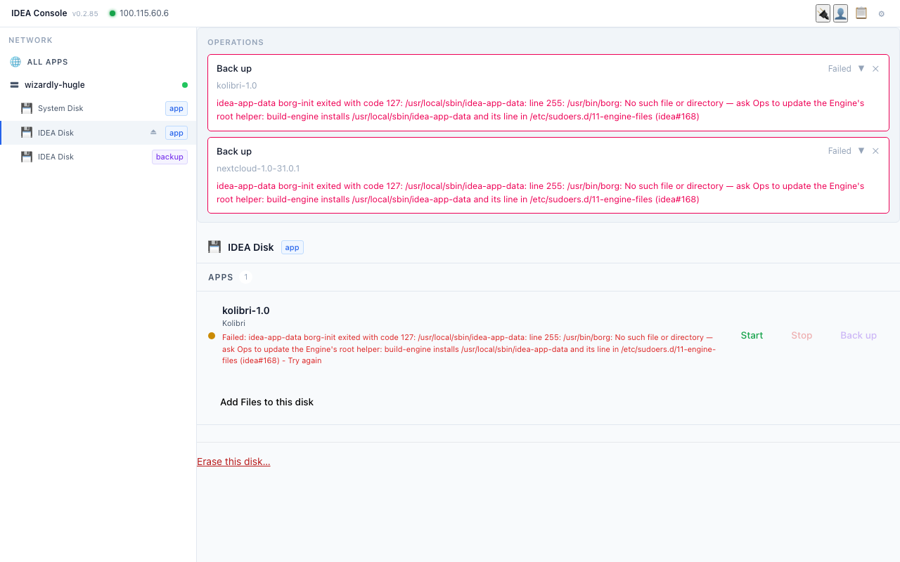
5. **Important (seen on the demo box):** the restore **moves** the app. Kolibri is no longer listed on the System Disk (it now shows only the other apps), and the restored Kolibri is **stopped** (orange dot, **Start** button) until someone starts it. Kolibri is not reachable until it is started. So a restore is for a real breakdown, not for testing on a working school box.
   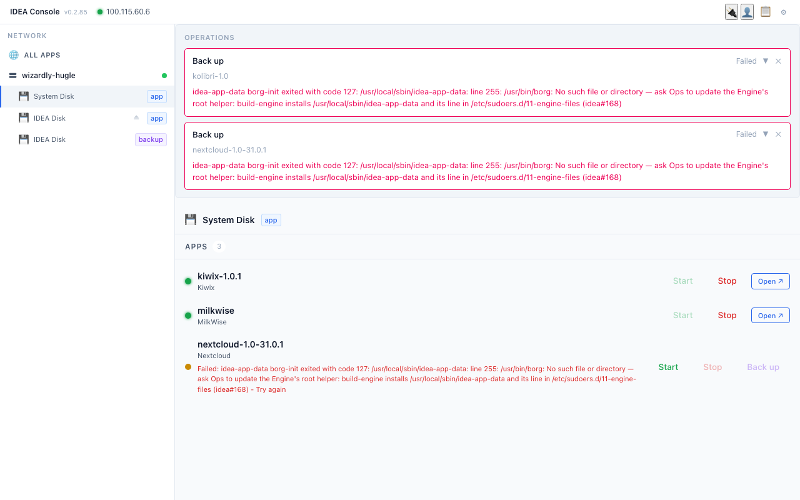
Starting the restored Kolibri and checking its classes: **to confirm** with the IDEA team.

#### Known Console quirks (v0.2.85)
- The **green dot** next to an app in ALL APPS is not always the real app state: on the demo box Nextcloud showed green while it was stopped. Check whether **Open** works.
- An app's version label can be out of date (Nextcloud showed **1.0-31.0.1** while 1.1-31.0.1 was installed).
- After an erase the disk can disappear from the list for a while (Engine lock bug). Do not erase again; call your IDEA contact.
- Old red **Back up Failed** messages stay in OPERATIONS until closed with ✕.
