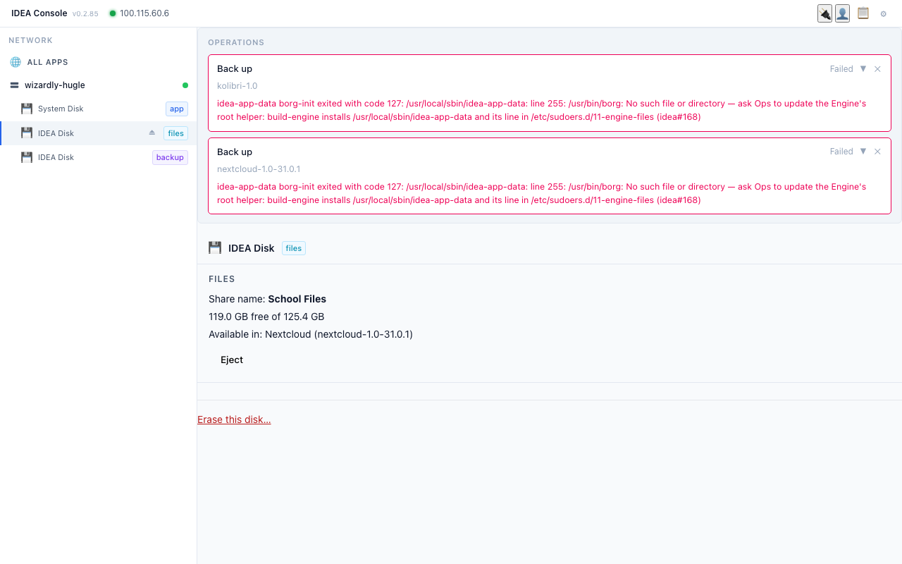
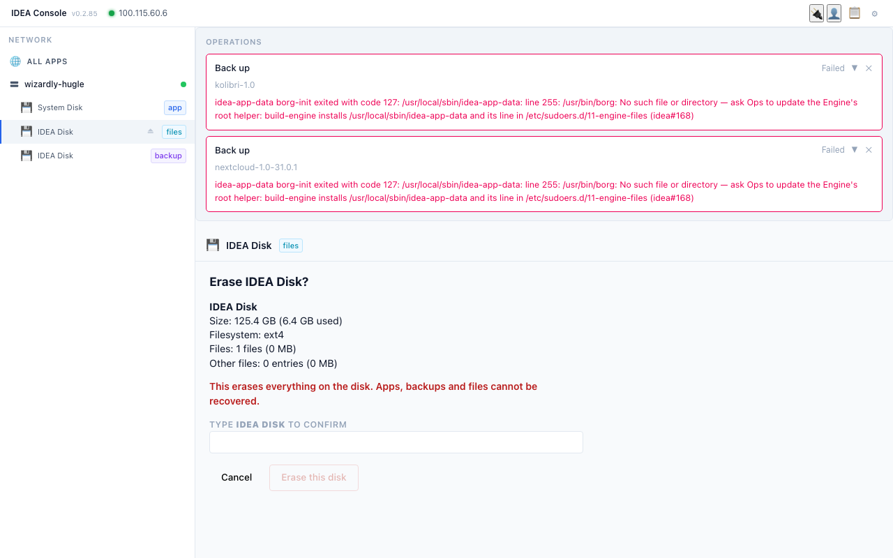
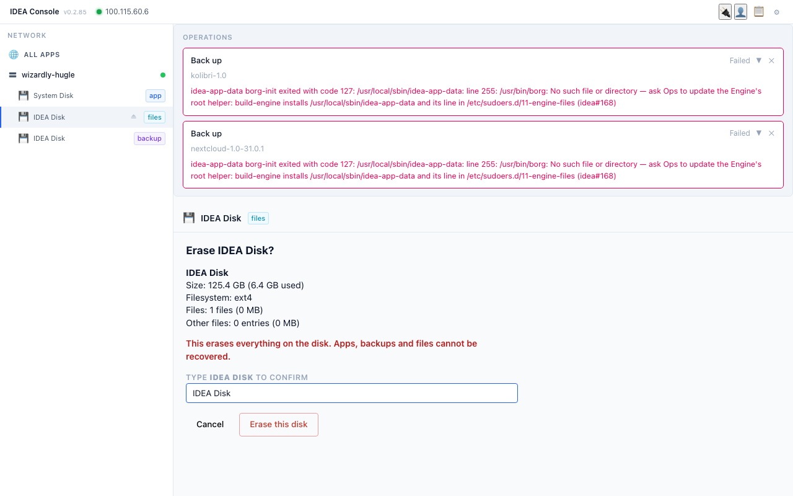
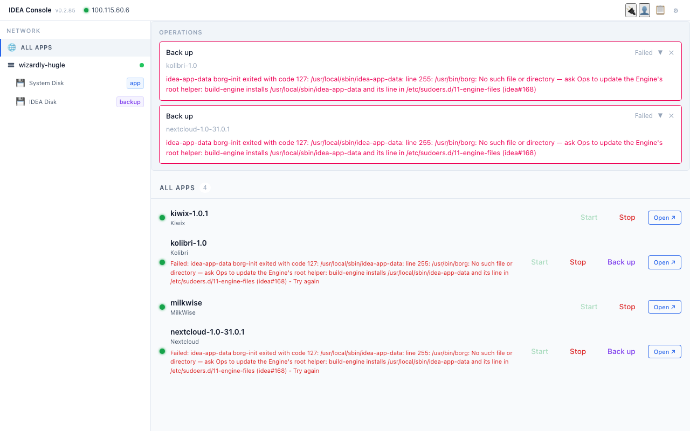

# 9. Keeping data safe: the Backup Disk (concepts)

Making and restoring backups is done by the operator and practised on a test Pi. Teachers should know:
- A **Backup Disk** is a separate disk with the **backup** badge in the Console.
- It saves the **apps' data**: Kolibri (classes, learners, progress) and Nextcloud (accounts, files inside Nextcloud).
- It does **not** save Files Disk content (version 1).
- During a backup, the app stops for a short time and then starts again. Plan backups outside lesson time.
- If a Pi breaks, the operator restores the latest backup onto a new disk. You lose only what was done after the last backup.
- Never unplug a disk while a backup is running. If it happens, the backup restarts next time the disk is connected.
How often the school backs up (each time the disk is plugged in, or on request): **to confirm** per school.

## Hands-on (operator, captured on the demo box 2026-10-12/13)

### B2. Make a Backup Disk
1. Plug in a spare disk. If it is new, it first has to become an empty **IDEA Disk** (chapter 8, Erase).
2. Select the **IDEA Disk** marked **empty** and click **Make this a Backup Disk** ("Link instances and choose a backup schedule").
   
3. Choose when backups run: **On demand** (only when you press **Back up**; used in the demo), **Immediate** (as soon as the disk is docked) or **Scheduled**.
   
4. Under **LINK TO INSTANCES**, tick only the school apps to protect (demo: **kolibri-1.0** and **nextcloud-1.0-31.0.1**). Leave other apps unticked.
   
5. Click **Configure Backup Disk**. The disk gets the **backup** badge and a **Backups** list: each linked app, "Never backed up", and **Restore**.
   

### B3. Run a backup
1. In **ALL APPS**, each linked app row has a **Back up** button next to Start / Stop / Open. Click it for Kolibri.
   
2. The app stops for a short time while it is copied, then starts again. On the Backup Disk the app shows **Operation in progress**. Do this outside lesson time.
   
3. When it is done, the Backups list shows **Last backup: <date, time>** (demo: Kolibri 8:46, Nextcloud 8:49, about 3 minutes each). Repeat for Nextcloud.
   
4. The **OPERATIONS** box at the top keeps old messages (in the demo: failed attempts from the day before, when the backup tool was not yet installed). Check the **Last backup** time, not old messages. Close old messages with ✕.

### B4. Restore after a crash
1. On the Backup Disk, each app in the **Backups** list has a **Restore** button.
   
2. Restore needs a **target disk**: a spare, empty IDEA Disk to put the app on. On the demo box it says **"No available target disks."** because the only other disks are the Files Disk and the System Disk, and the Console does not offer those as targets.
3. With a spare empty IDEA Disk plugged in, choose it as the target and confirm (**to confirm**: not tried yet; by design the latest backup is unpacked onto the target disk and the app runs from there).
Never restore onto a disk that holds other apps you need.

#### B4 attempt on the demo box (2026-10-13): preparing a target disk
To get a target disk, the operator erased the 128 GB Files Disk (**Erase this disk…** on the Files Disk view).
1. The Files Disk view shows the share name, free space, **Eject** and **Erase this disk…**.
   
2. The dialog **Erase IDEA Disk?** shows size (125.4 GB), filesystem, number of files and a red warning. Check the size: this must not be the Backup Disk or the System Disk.
   
3. Type the disk name exactly as written (**IDEA Disk**, not in capitals) to enable **Erase this disk**.
   
4. On the demo box the disk then disappeared from the list (the Engine bug described in chapter 8). The restore was stopped here; the original apps kept running on the System Disk.
   
The restore steps after this point are **to confirm** once the IDEA team has fixed the bug.
