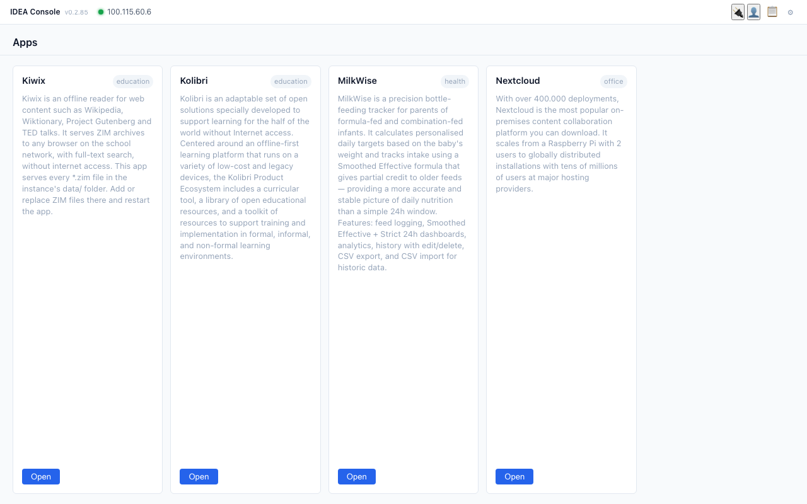

# 10. Console basics

## C1. Read the Console
1. The **Apps** page shows one card per app with a short description and a category (education, office, …). 
2. A card with a blue **Open** button is running. A greyed-out card with **Not available** is not.
3. The green dot and address at the top show the Console is connected to the IDEA box. Orange "Connecting…" means wait a moment.
## C2. App not running?
Do not try to start it. Note the app name and tell your operator.
## C3–C4. Operator area
The icons top right (plug: Connection Management, person: Operator Login, clipboard: Command History, gear: Settings) are for operators. The disk view (Network, disks, Eject, Erase, Install) is only visible after **Operator Login** and is **not** covered in this teacher guide (**to confirm** with Steve whether to show it).
