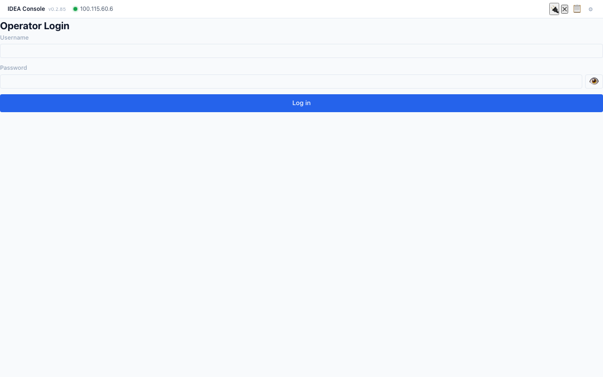
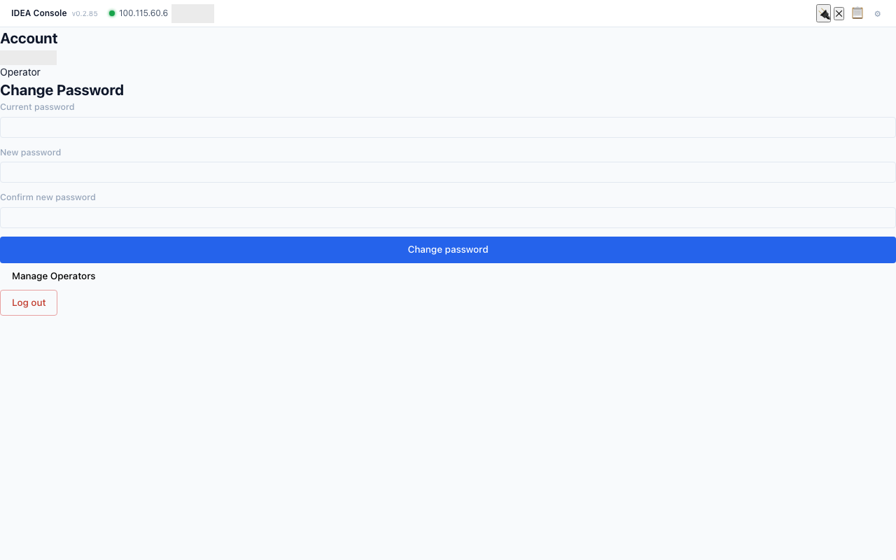
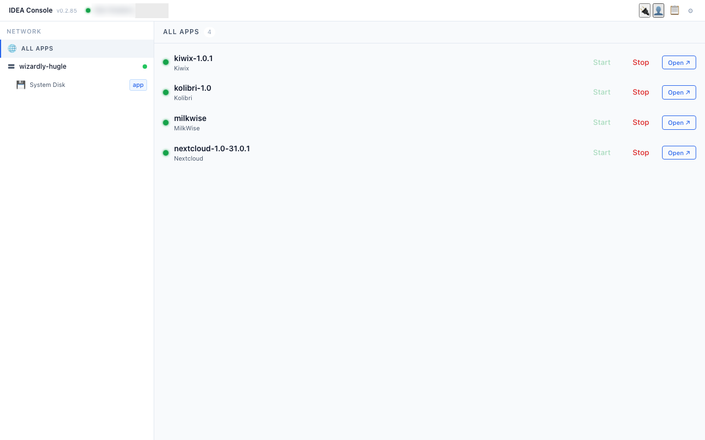
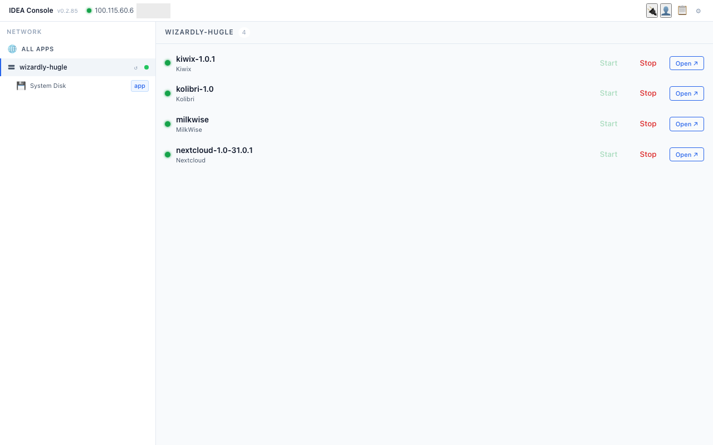
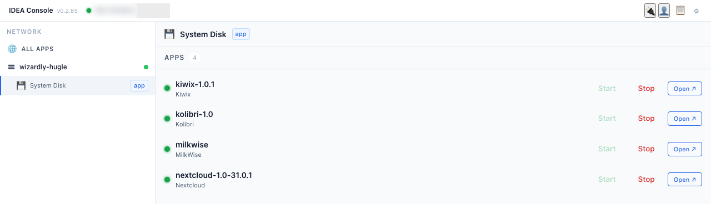
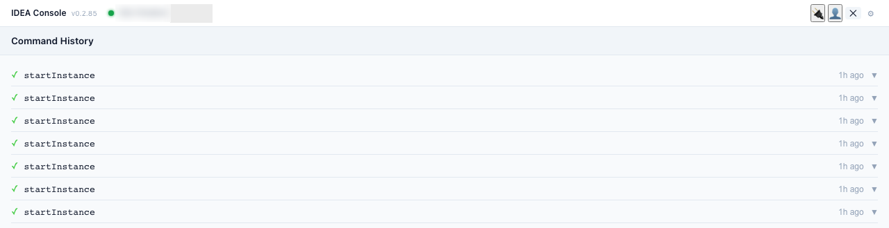
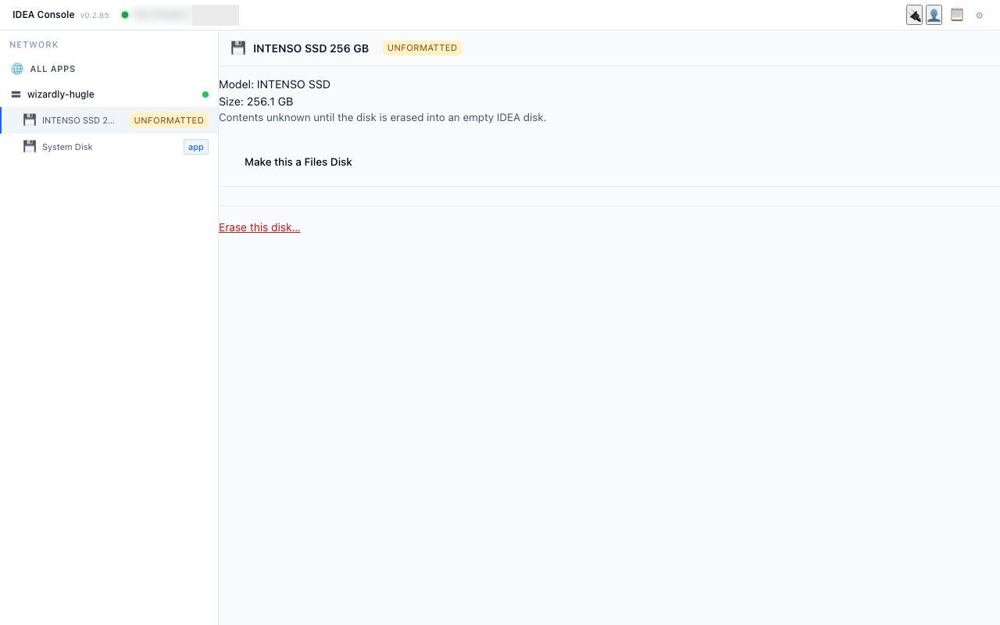
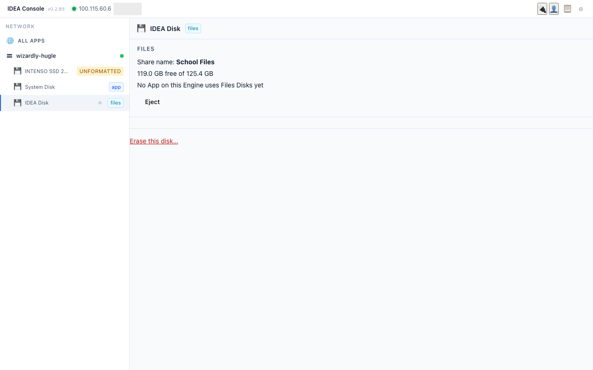

# 11. Operator basics

For the school's IDEA operator, not for every teacher. Console v0.2.85 on the demo box. Everything here is **look only**: do not press Start, Stop or other action buttons unless your IDEA contact asks you to.

## O1. Operator Login
1. In the Console, click the person icon (top right). The **Operator Login** panel opens with a username and a password field (the eye icon shows/hides the password).
   
2. Type the operator username and password, click **Log in**. The **Account** panel then shows your name, role **Operator**, **Change Password**, **Manage Operators** and **Log out**.
   
3. **On a real school deployment, change the default operator password straight away** (Account > Change Password: current password, new password twice, **Change password**). Keep the new password with the school head, not on a sticker on the box.
4. Close the panel with **✕**. Use **Log out** in the same panel when you are done.

## O2. The Network view: Engine and disks
1. After login the left side shows **NETWORK**: **ALL APPS**, then the IDEA box (Engine, here `wizardly-hugle`, with an **Online** status) and its disks.
   
2. Click the Engine name to select it.
   
3. Click a disk (here **System Disk**). Each disk shows role badges: **app**, **backup**, **files**, **empty**. The right side lists the **Apps** on that disk with a count.
   

## O3. App status
1. Each app row shows the app name and version (e.g. `kolibri-1.0`), a coloured status dot, and buttons **Start**, **Stop** and **Open ↗**.
2. Click the status dot (**Show details**) to see: STATUS (e.g. **Running**), VERSION, ENGINE, PORT, CREATED, LAST STARTED, **LAST BACKUP** (e.g. "Never"), the description, a short log, and CONTAINER METRICS (CPU, memory, network, disk).
   
3. Only Start or Stop an app when your IDEA contact asks you to. Never touch **MilkWise** or other non-school apps.

## O4. Command History
1. The clipboard icon (top right) lists recent Engine commands (for example `startInstance`, `installApp`) with ✓ (done) or ✗ (failed) and how long ago. Use it when you report a problem.
   

## O4b. The ↺ button is REBOOT
The small **↺** next to the Engine name is **Reboot engine** (it restarts the whole IDEA box). Never press it during lessons.

## O4c. A new (unformatted) USB disk
1. A new disk appears under the Engine with its model and size and an **UNFORMATTED** badge (e.g. "INTENSO SSD 256 GB — 256.1 GB").
   
2. Its view shows Model, Size, "Contents unknown until the disk is erased into an empty IDEA disk", and two buttons: **Make this a Files Disk** and **Erase this disk…**.
3. **Erase this disk…** opens a confirmation with the disk name, model, size and contents, the red warning "This erases everything on the disk…", and a box **TYPE <disk name> TO CONFIRM**. The **Erase this disk** button stays grey until the name is typed exactly. Press **Cancel** if anything looks wrong.
   
   Note: the dialog shows model and size but **not the serial number**. If two identical disks are plugged in, unplug one before erasing.

## O5. Safely ejecting a disk
The **System Disk** (the box's own disk) has no Eject button. A USB IDEA Disk has a small **⏏** icon next to its name in the Network list, and an **Eject** button in its disk view (below the disk details, above **Erase this disk…**). Eject lists what will stop before you confirm (**to confirm**: not clicked on the demo box). Never eject or unplug during a backup.

## O6. Dangerous buttons
**Erase this disk…**, **Install App**, **Make this a Files/Backup Disk**, **Stop**: only with your IDEA contact on the phone. (Erase and Make this a Files Disk appear only on non-system disks; confirmed on a spare disk. The System Disk has neither.)

## O7. Backup and restore (later)
See chapter 9 (hands-on): Make this a Backup Disk, On demand / Immediate / Scheduled, LINK TO INSTANCES, **Back up** button on each linked app row, **Restore** on the Backup Disk (needs a spare target disk). The **LAST BACKUP** line in app details (O3) shows when an app was last backed up.
